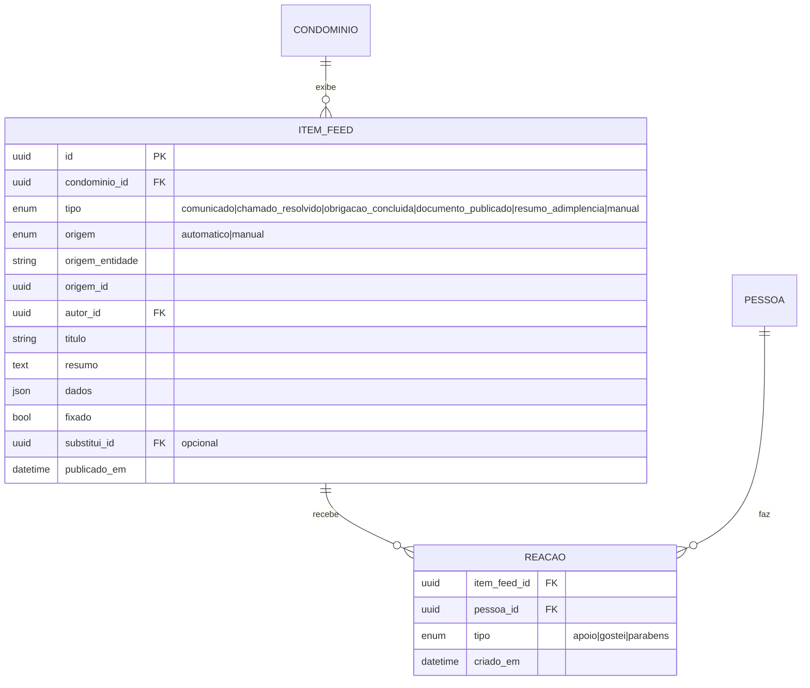

# Especificação — Feed de Transparência

> **Status:** proposta aprovada em conceito (2026-10-15), regras de curadoria a validar
> **Release:** proto-feed no MVP (lista de comunicados) · feed completo na v2 · itens de obrigações e documentos na v3
> **Relacionado:** `visao-geral-da-solucao.md` (seções 5, 10, 11), ADR-010

## 1. Propósito

Mostrar aos moradores, numa linha do tempo, o que está sendo feito no condomínio: chamados de área comum resolvidos, manutenções concluídas, documentos publicados e comunicados do síndico. Reforça o posicionamento de transparência com prova e dá visibilidade ao trabalho do síndico sem esforço extra.

## 2. Regras de negócio

1. **Itens automáticos:** gerados pelo sistema quando ocorre um evento publicável. Não podem ser removidos nem editados pelo síndico.
   - Chamado de área comum resolvido (com o que foi feito, custo e foto, se houver).
   - Obrigação legal concluída (com comprovante).
   - Documento publicado (ata, convenção, regimento).
   - Comunicado publicado.
   - Resumo mensal de adimplência **agregado** (ex.: "11 de 12 unidades em dia").
2. **Itens manuais do síndico:** o síndico pode publicar itens próprios (ex.: fotos de uma obra em andamento). Publicados, não podem ser editados; correções geram novo item vinculado ao anterior.
3. **Curadoria do síndico:** o síndico pode **fixar** itens no topo. Não pode ocultar itens automáticos, para que o feed não vire vitrine seletiva.
4. **Chamado contestado:** se a resolução de um chamado for contestada, o item no feed exibe o status "resolução contestada" até nova resolução.
5. **Sem posts de moradores e sem comentários.** Manifestações e reclamações seguem pelo módulo de chamados, que tem dono, status e prova.
6. **Reações apenas positivas:** moradores podem reagir com **Apoio**, **Gostei** ou **Parabéns**.
   - Uma reação por pessoa por item; pode trocar ou remover.
   - Exibe contagem por tipo; a lista de quem reagiu é visível ao tocar na contagem.
   - Reações são a única exceção ao princípio append-only, por não terem valor de prova.
7. **Privacidade:** nunca exibir dados financeiros por unidade, chamados privados ou dados pessoais além do nome do autor do registro.
8. **Visibilidade:** todos com vínculo ativo ou papel ativo no condomínio. Proprietário não residente também vê.
9. Cada item aponta para o registro original (chamado, ocorrência de obrigação, documento, comunicado).

## 3. Requisitos funcionais

| ID | Requisito | Prioridade | Release |
|---|---|---|---|
| RF-FEED-01 | A tela inicial do morador exibe o feed do condomínio em ordem cronológica decrescente, com itens fixados no topo. | M | MVP (só comunicados) / v2 |
| RF-FEED-02 | O sistema gera item de feed automaticamente quando um chamado de área comum é resolvido. | M | v2 |
| RF-FEED-03 | O sistema gera item de feed quando uma obrigação legal é concluída ou um documento é publicado. | M | v3 |
| RF-FEED-04 | O sistema gera item mensal com o resumo agregado de adimplência. | S | v2 |
| RF-FEED-05 | O síndico publica itens manuais com texto e fotos. | S | v2 |
| RF-FEED-06 | O síndico fixa e desafixa itens; não pode ocultar itens automáticos. | S | v2 |
| RF-FEED-07 | Moradores reagem com Apoio, Gostei ou Parabéns; uma reação por pessoa por item, alterável. | S | v2 |
| RF-FEED-08 | Item de chamado exibe "resolução contestada" quando aplicável. | M | v2 |
| RF-FEED-09 | Cada item leva ao registro de origem. | M | v2 |

## 4. Requisitos não funcionais específicos

| ID | Requisito |
|---|---|
| RNF-FEED-01 | Feed paginado (ex.: 20 itens por página) sem consultas N+1. |
| RNF-FEED-02 | Itens do feed nunca contêm dados financeiros por unidade nem conteúdo de chamados privados (teste automatizado obrigatório). |
| RNF-FEED-03 | Itens escritos na mesma transação do evento de origem, para não haver item sem origem nem origem sem item. |

## 5. Modelagem



Restrição: `REACAO` única por (`item_feed_id`, `pessoa_id`).

Implementação: os serviços de cada módulo (chamados, obrigações, documentos, comunicação) chamam um serviço público do módulo Feed ao concluir um evento publicável. O Feed não lê tabelas internas de outros módulos.

## 6. Histórias de usuário

**HU-FEED-01 — Ver o que está sendo feito**
Como morador, quero ver no início do app o que foi resolvido e publicado no condomínio, para saber que o prédio está sendo cuidado sem precisar perguntar.

```gherkin
Dado que o síndico resolveu um chamado de área comum com foto e custo
Quando um morador abre o app
Então o item aparece no topo do feed com o que foi feito, o custo e a foto
E ao tocar no item o morador vê o chamado completo
```

**HU-FEED-02 — Reconhecer o trabalho**
Como morador, quero reagir com "Parabéns" a uma manutenção concluída, para reconhecer o trabalho do síndico.

```gherkin
Dado um item de feed
Quando reajo com "Parabéns" e depois com "Apoio"
Então fica registrada apenas a reação "Apoio"
E a contagem exibe 1 reação "Apoio"
```

**HU-FEED-03 — Destacar um aviso**
Como síndico, quero fixar um comunicado importante no topo do feed, para que ninguém deixe de ver.

**HU-FEED-04 — Feed não esconde contestação**
Como morador, quero ver quando a resolução de um chamado foi contestada, para que o feed reflita a situação real.

```gherkin
Dado um item de chamado resolvido no feed
Quando o autor do chamado contesta a resolução
Então o item passa a exibir "resolução contestada"
E o síndico não consegue ocultar o item
```

## 7. ADR-010 — Feed sem posts de moradores e sem comentários

- **Contexto:** desejo de um feed do condomínio; chat entre moradores já descartado (ADR-008).
- **Decisão:** feed de transparência gerado por eventos do sistema e por publicações do síndico; moradores apenas reagem com reações positivas; sem posts livres nem comentários.
- **Motivos:** evitar concorrência com o grupo de WhatsApp, conflitos públicos, moderação a cargo do síndico e retenção de conteúdo livre sob LGPD. Reclamações seguem pelo módulo de chamados.
- **Consequências:** feed com baixo custo de moderação e alto valor de transparência; só reações positivas exigem que o canal de contestação (chamados) seja visível e funcione bem, para o feed não parecer propaganda.
- **Status:** proposta.

## 8. Questões em aberto

- QF-01: o síndico deve poder publicar itens manuais desde a v2, ou só itens automáticos e comunicados?
- QF-02: a lista de quem reagiu deve ser visível a todos ou só a contagem?
