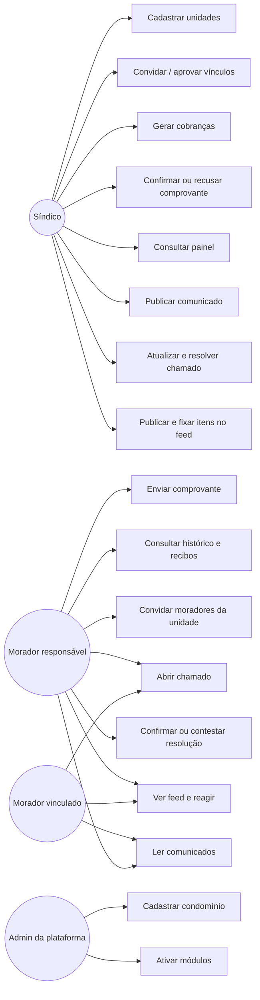
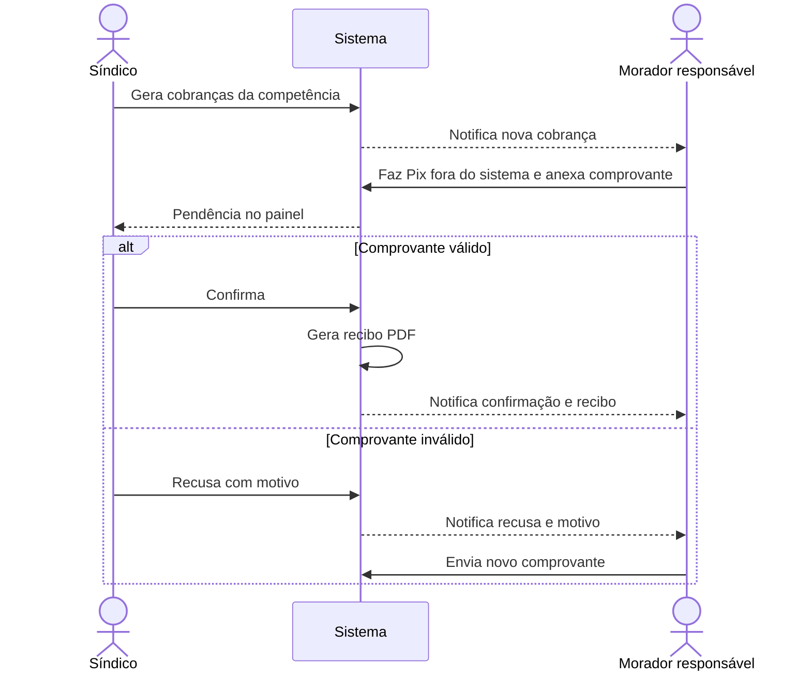
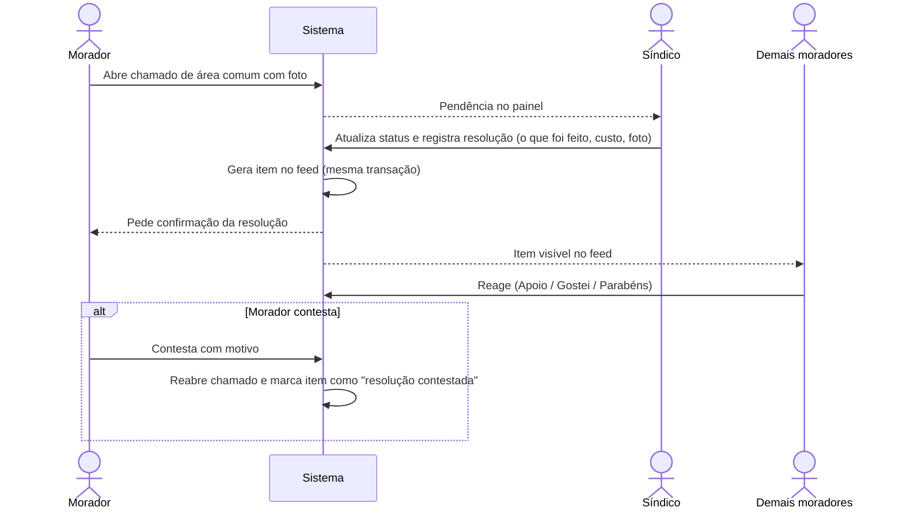
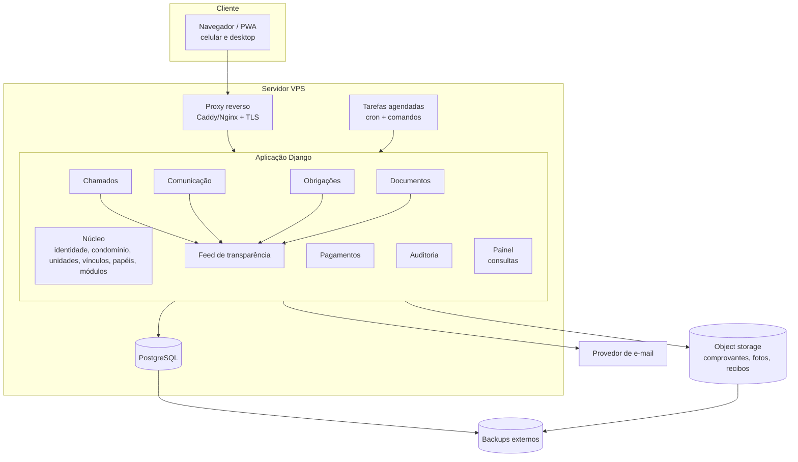
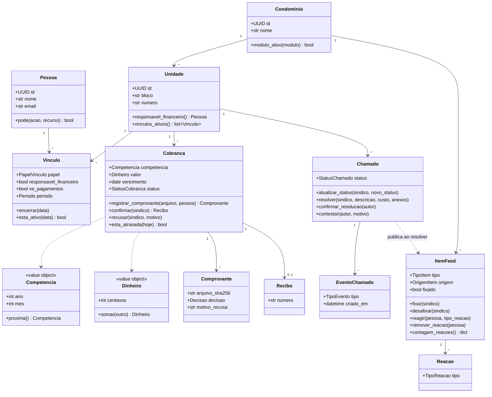
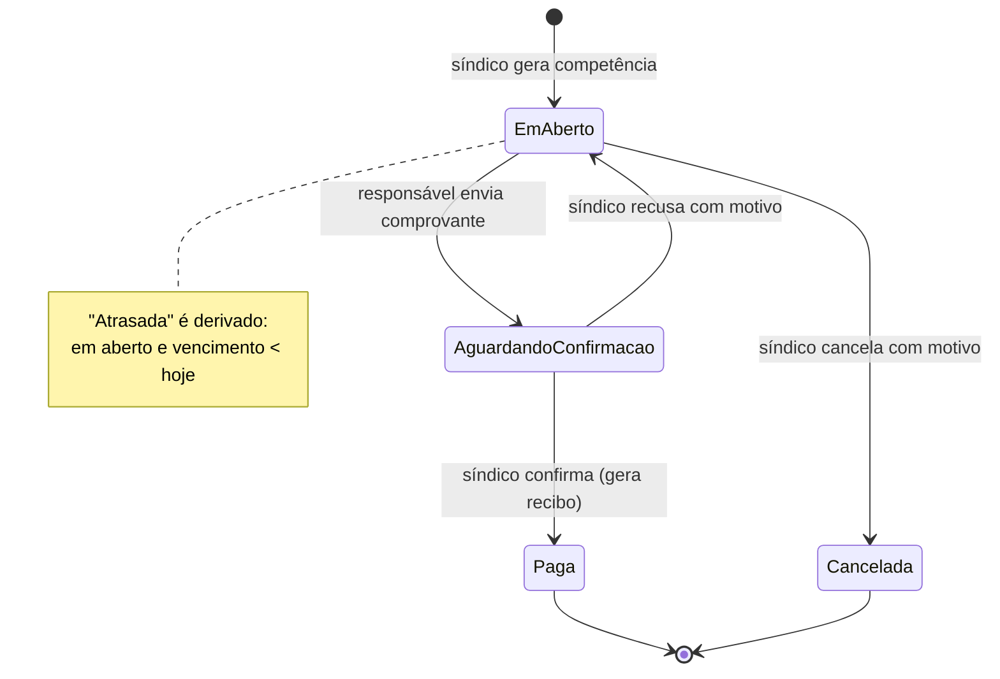
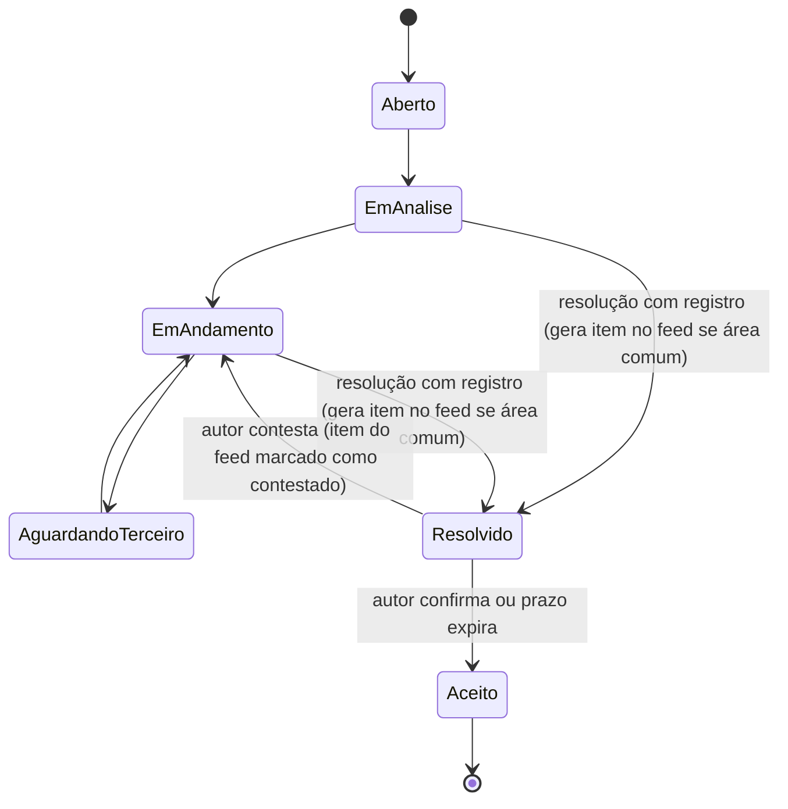

# Gestão de Condomínio — Visão Geral da Solução

> **Status:** rascunho v0.2 — fase de idealização (Sprint 0 / descoberta)
> **Nome do projeto:** provisório (`gestao-condominio`)
> **Autor:** Heitor Oliveiro
> **Última atualização:** 2026-10-15
> **Documentos relacionados:** `spec-feed-transparencia.md`, `questoes-em-aberto.md`, `changelog.md`
> **Observação:** os diagramas estão em Mermaid. O preview do Google Drive não renderiza Mermaid; abra no GitHub, VS Code ou Obsidian para visualizar.

---

## Sumário

1. Problema
2. Objetivos
3. Público-alvo e posicionamento
4. Personas
5. Requisitos funcionais (RF)
6. Requisitos não funcionais (RNF)
7. Casos de uso e histórias de usuário
8. Stack sugerida
9. Metodologias
10. Design da arquitetura
11. Modelagem de dados
12. Diagrama de classes e estados
13. Plano de testes
14. Cronograma, estimativas de prazo e custo
15. Riscos
16. Fora de escopo (implantação futura)
17. Glossário (linguagem ubíqua)

---

## 1. Problema

A gestão de condomínios pequenos e médios, especialmente os administrados por síndico morador voluntário, acontece de forma fragmentada: WhatsApp, cadernos, planilhas e comprovantes soltos. Isso gera quatro problemas centrais:

1. **Falta de rastreabilidade de pagamentos.** O morador envia o Pix e o comprovante pelo WhatsApp, o síndico devolve um recibo simples. Não existe histórico confiável para nenhuma das partes, e esquecimentos geram atrito.
2. **Falta de prova sobre demandas e manutenções.** Solicitações de moradores se perdem; quando resolvidas, não há registro do que foi feito, por quem e a que custo. Pesquisas do setor apontam que a principal queixa dos moradores contra síndicos é a de que eles não resolvem as reclamações, e há relatos de sistemas que permitem encerrar chamados sem resolução.
3. **Trabalho do síndico invisível.** O que é feito no prédio raramente chega ao conhecimento dos moradores, o que alimenta desconfiança mesmo quando a gestão é boa.
4. **Sobrecarga e exposição do síndico.** O síndico responde pessoalmente pela conservação do prédio e pela prestação de contas (Código Civil, art. 1.348), acumulando prazos legais (caixa d'água, extintores, para-raios, elevador, AVCB, seguro) sem uma ferramenta que o lembre e guarde comprovantes.

O mercado já oferece plataformas completas (uCondo, TownSq, Condomob, Superlógica, entre outras), mas elas são orientadas a administradoras e a condomínios maiores, com escopo amplo e foco financeiro (boletos, conta digital).

## 2. Objetivos

### Objetivo geral

Melhorar a **eficiência, a transparência e a comunicação** de condomínios residenciais, facilitando principalmente a rotina do síndico, por meio de um sistema web em que toda ação relevante fica registrada com autor, data e prova.

### Objetivos específicos

- OE-01: substituir o fluxo "Pix + comprovante no WhatsApp + recibo manual" por um fluxo rastreável de cobrança, comprovante, confirmação e recibo.
- OE-02: dar ao síndico uma visão rápida do que exige ação (pendências, inadimplência, chamados, prazos).
- OE-03: registrar chamados de manutenção com prova de resolução, permitindo ao morador confirmar ou contestar.
- OE-04: centralizar comunicados oficiais com confirmação de leitura.
- OE-05: lembrar o síndico de obrigações legais e guardar seus comprovantes.
- OE-06: permitir que cada condomínio ative apenas os módulos compatíveis com sua realidade.
- OE-07: tornar visível aos moradores o que é feito no condomínio, por meio de um feed de transparência gerado pelas próprias ações registradas.
- OE-08 (pessoal/acadêmico): servir como projeto de portfólio escrito pelo autor em Python, aplicando DDD, TDD e SDD.

### Métrica de sucesso do piloto

- 100% das cobranças do prédio piloto registradas no sistema por 3 meses seguidos.
- Síndico deixa de emitir recibos fora do sistema.
- Pelo menos 70% das unidades com responsável financeiro ativo no sistema.

## 3. Público-alvo e posicionamento

**Público primário (piloto e primeira fase):** condomínios residenciais pequenos (aprox. 8 a 50 unidades), com síndico morador voluntário ou síndico profissional autônomo, sem administradora ou com administradora que não oferece ferramenta digital.

**Público secundário (futuro):** síndicos profissionais que gerem vários prédios e administradoras pequenas.

**Piloto:** o prédio onde o autor mora (sem área comum).

**Posicionamento: transparência com prova.** Em vez de competir em quantidade de funcionalidades, o diferencial é que nenhuma ação relevante é apagável: chamados só fecham com registro do que foi feito, pagamentos têm comprovante e decisão registrada, correções viram novos registros, e o feed mostra aos moradores o que foi feito, sem que o síndico possa ocultar itens automáticos. O registro que protege o morador também protege o síndico honesto.

### Benchmark resumido

| Concorrente | Foco | O que oferecem | Observação |
|---|---|---|---|
| uCondo | Administradoras e condomínios | Avisos, reservas, faturas/boletos, acessos, ocorrências com foto, enquetes, prestação de contas, denúncia sigilosa, conta condomínio | Forte no financeiro |
| TownSq | Síndicos e administradoras | Ocorrências, circulares, áreas comuns, visitantes, classificados, multi-condomínio | Presença internacional |
| Condomob | Gestão financeira | Boleto online, inadimplência automatizada, agenda de cobrança | — |
| Superlógica Condomínios | Administradoras | Cobrança, inadimplência, prestação de contas | ERP completo |
| Omeupredio | Síndico | Balancete mensal, relatório de taxas do morador | — |

Funcionalidades comuns a quase todos: comunicados, reservas, ocorrências/chamados, documentos, controle de visitantes e boletos.

## 4. Personas

### P1 — Síndico morador voluntário ("Marcos", 54 anos)
Mora no prédio, trabalha em horário comercial, assumiu o cargo porque ninguém quis. Usa celular para tudo, computador às vezes. Dor: perde comprovantes, esquece prazos, é cobrado no grupo de WhatsApp, e o trabalho que faz não é percebido. Quer: saber rápido o que precisa fazer, ter como provar o que fez e que os moradores vejam isso.

### P2 — Síndico profissional ("Renata", 41 anos)
Gere 4 a 6 prédios pequenos. Usa computador no escritório e celular na rua. Quer: ver pendências de todos os prédios e reduzir tempo com cobrança e mensagens.

### P3 — Morador proprietário, responsável financeiro ("Heitor", 30 anos)
Paga a taxa por Pix. Quer: enviar comprovante em segundos, receber recibo, consultar histórico sem depender do síndico e saber o que está sendo feito no prédio.

### P4 — Inquilino ("Júlia", 27 anos)
Paga a taxa por contrato com o dono. Quer: abrir chamado quando algo quebra e acompanhar o andamento.

### P5 — Proprietário não residente ("Sr. Antônio", 68 anos)
Aluga o apartamento. Prefere computador. Quer: ver se o inquilino está pagando e acompanhar o que é feito no prédio.

### P6 — Morador vinculado ("Paulo", 33 anos)
Cônjuge ou quem divide o apartamento. Quer: receber comunicados, ver o feed e abrir chamados. Não precisa ver pagamentos.

### P7 — Conselheiro (futuro)
Fiscaliza a gestão. Quer: acesso de leitura à prestação de contas e aos chamados.

### P8 — Porteiro (futuro, módulo Encomendas)
Quer: registrar encomenda com foto e avisar o morador.

### P9 — Administrador da plataforma (o autor)
Cadastra condomínios, ativa módulos, dá suporte.

## 5. Requisitos funcionais (RF)

Prioridade MoSCoW: **M** (must), **S** (should), **C** (could), **W** (won't nesta fase). Release: **MVP**, **v2**, **v3**, **Futuro**.

### 5.1 Núcleo (sempre ativo)

| ID | Requisito | Prioridade | Release |
|---|---|---|---|
| RF-NUC-01 | O administrador da plataforma deve cadastrar condomínios. | M | MVP |
| RF-NUC-02 | O síndico deve cadastrar as unidades do condomínio (bloco, número). | M | MVP |
| RF-NUC-03 | O síndico deve convidar o responsável de cada unidade por link ou e-mail. | M | MVP |
| RF-NUC-04 | Uma pessoa pode solicitar vínculo a uma unidade; o vínculo só se torna ativo após aprovação do síndico. | M | MVP |
| RF-NUC-05 | O responsável da unidade deve convidar outros moradores da mesma unidade. | M | MVP |
| RF-NUC-06 | Cada vínculo deve ter papel (proprietário, inquilino, morador), indicação de responsável financeiro e datas de início e fim. | M | MVP |
| RF-NUC-07 | Encerrar um vínculo deve registrar a data de fim sem apagar o histórico. | M | MVP |
| RF-NUC-08 | O sistema deve suportar papéis no condomínio (síndico, subsíndico, conselheiro, porteiro, administradora) independentes dos vínculos com unidades. | M | MVP (síndico) / v2+ (demais) |
| RF-NUC-09 | Uma mesma pessoa pode ter vínculos com várias unidades e papéis em vários condomínios. | M | MVP |
| RF-NUC-10 | O administrador da plataforma deve ativar e desativar módulos por condomínio. | M | MVP |
| RF-NUC-11 | Módulo desativado deve manter seus dados em modo somente leitura. | S | v2 |
| RF-NUC-12 | Autenticação com e-mail e senha, recuperação de senha por e-mail. | M | MVP |

### 5.2 Módulo Pagamentos (MVP)

| ID | Requisito | Prioridade | Release |
|---|---|---|---|
| RF-PAG-01 | O síndico deve gerar as cobranças de uma competência (mês/ano) para todas as unidades, com valor e vencimento. | M | MVP |
| RF-PAG-02 | O síndico deve poder ajustar o valor de uma cobrança individual antes do envio de comprovante, com registro do motivo. | S | MVP |
| RF-PAG-03 | O responsável financeiro deve enviar comprovante (imagem ou PDF) vinculado a uma cobrança. | M | MVP |
| RF-PAG-04 | O síndico deve confirmar ou recusar o comprovante; a recusa exige motivo. | M | MVP |
| RF-PAG-05 | Ao confirmar, o sistema deve gerar recibo em PDF com identificação única. | M | MVP |
| RF-PAG-06 | Morador e síndico devem consultar o histórico de cobranças, comprovantes, decisões e recibos da unidade. | M | MVP |
| RF-PAG-07 | O sistema deve marcar como atrasada a cobrança sem comprovante confirmado após o vencimento. | M | MVP |
| RF-PAG-08 | O sistema deve notificar o responsável financeiro sobre nova cobrança, vencimento próximo e decisão do síndico. | S | MVP |
| RF-PAG-09 | Nenhum comprovante, decisão ou recibo pode ser apagado; correções geram novos registros. | M | MVP |

### 5.3 Painel do síndico e tela inicial do morador (MVP)

| ID | Requisito | Prioridade | Release |
|---|---|---|---|
| RF-PAI-01 | Exibir pendências que dependem do síndico, ordenadas por urgência: comprovantes aguardando decisão, chamados sem resposta há mais de X dias, chamados contestados, obrigações a vencer em 30 dias. | M | MVP (pagamentos) / v2+ (demais) |
| RF-PAI-02 | Exibir situação de pagamentos da competência atual por unidade: confirmado, aguardando confirmação, em aberto, atrasado. | M | MVP |
| RF-PAI-03 | Exibir resumo de chamados: abertos, em andamento, resolvidos e tempo médio de resolução. | S | v2 |
| RF-PAI-04 | Atalhos para chamados, comunicados, feed e unidades. | S | MVP |
| RF-PAI-05 | Tela inicial do morador: feed do condomínio (no MVP, lista de comunicados), situação da própria unidade e chamados abertos por ele. | S | MVP |

### 5.4 Comunicados (MVP)

| ID | Requisito | Prioridade | Release |
|---|---|---|---|
| RF-COM-01 | O síndico deve publicar comunicados para todo o condomínio. | M | MVP |
| RF-COM-02 | O sistema deve registrar a confirmação de leitura de cada pessoa. | S | MVP |
| RF-COM-03 | Comunicados publicados não podem ser editados; correções geram um novo comunicado vinculado ao anterior. | S | MVP |

### 5.5 Feed de Transparência (proto-feed no MVP, completo na v2)

> Especificação completa: `spec-feed-transparencia.md`.

Linha do tempo do condomínio gerada pelas ações registradas no sistema e por publicações do síndico. Moradores não publicam nem comentam; apenas reagem com reações positivas.

| ID | Requisito | Prioridade | Release |
|---|---|---|---|
| RF-FEED-01 | A tela inicial do morador exibe o feed em ordem cronológica decrescente, com itens fixados no topo. | M | MVP (só comunicados) / v2 |
| RF-FEED-02 | O sistema gera item automaticamente quando um chamado de área comum é resolvido. | M | v2 |
| RF-FEED-03 | O sistema gera item quando uma obrigação legal é concluída ou um documento é publicado. | M | v3 |
| RF-FEED-04 | O sistema gera item mensal com resumo agregado de adimplência (sem identificar unidades). | S | v2 |
| RF-FEED-05 | O síndico publica itens manuais com texto e fotos. | S | v2 |
| RF-FEED-06 | O síndico fixa e desafixa itens; não pode ocultar itens automáticos. | S | v2 |
| RF-FEED-07 | Moradores reagem com Apoio, Gostei ou Parabéns; uma reação por pessoa por item, alterável. | S | v2 |
| RF-FEED-08 | Item de chamado exibe "resolução contestada" quando aplicável. | M | v2 |
| RF-FEED-09 | Cada item leva ao registro de origem. | M | v2 |

### 5.6 Módulo Chamados (v2)

| ID | Requisito | Prioridade | Release |
|---|---|---|---|
| RF-CHA-01 | Morador deve abrir chamado com categoria, descrição e fotos. | M | v2 |
| RF-CHA-02 | Síndico deve atualizar status (em análise, em andamento, aguardando terceiro, resolvido). | M | v2 |
| RF-CHA-03 | Resolver chamado exige registro do que foi feito; prestador, custo e foto são opcionais configuráveis. | M | v2 |
| RF-CHA-04 | O autor do chamado deve confirmar ou contestar a resolução; contestação reabre o chamado. | M | v2 |
| RF-CHA-05 | Chamado resolvido sem resposta do autor em N dias é considerado aceito. | S | v2 |
| RF-CHA-06 | Toda interação gera um registro na linha do tempo do chamado, que não pode ser editado nem apagado. | M | v2 |
| RF-CHA-07 | Chamados podem ser privados (só autor e síndico) ou de área comum (visíveis a todos e publicados no feed ao serem resolvidos). | S | v2 |

### 5.7 Módulo Obrigações legais (v3)

| ID | Requisito | Prioridade | Release |
|---|---|---|---|
| RF-OBR-01 | Catálogo de obrigações com periodicidade (ex.: limpeza de caixa d'água, recarga de extintores, inspeção de para-raios, manutenção de elevador, AVCB, seguro). | M | v3 |
| RF-OBR-02 | O síndico deve marcar quais se aplicam ao condomínio e a data da última execução. | M | v3 |
| RF-OBR-03 | O sistema deve gerar a próxima ocorrência e alertar com antecedência configurável. | M | v3 |
| RF-OBR-04 | Ao concluir uma ocorrência, o síndico anexa comprovante (laudo, nota, certificado), e o sistema publica item no feed. | M | v3 |

### 5.8 Módulo Documentos (v3)

| ID | Requisito | Prioridade | Release |
|---|---|---|---|
| RF-DOC-01 | Síndico publica documentos (convenção, regimento interno, atas), com item gerado no feed. | M | v3 |
| RF-DOC-02 | Moradores consultam e baixam documentos. | M | v3 |

### 5.9 Módulos futuros (detalhar quando houver condomínio interessado)

- **Reservas:** cadastro de áreas comuns, regras de reserva, bloqueio de conflito de horário.
- **Encomendas:** porteiro registra encomenda com foto, morador é notificado, retirada confirmada.

## 6. Requisitos não funcionais (RNF)

### Segurança

| ID | Requisito |
|---|---|
| RNF-SEG-01 | Senhas armazenadas com algoritmo de hash recomendado pelo framework (Argon2 ou PBKDF2), nunca em texto puro. |
| RNF-SEG-02 | Toda comunicação via HTTPS (TLS), com HSTS. |
| RNF-SEG-03 | Controle de acesso baseado em papéis com escopo (condomínio e unidade). Cada requisição deve verificar se a pessoa tem vínculo ou papel ativo no recurso acessado. |
| RNF-SEG-04 | Isolamento entre condomínios (multi-tenant): nenhuma consulta pode retornar dados de outro condomínio. Testes automatizados obrigatórios para isso. |
| RNF-SEG-05 | Proteção contra acesso direto a objetos de terceiros (IDOR): identificadores não sequenciais (UUID) em URLs e verificação de permissão em todo acesso. |
| RNF-SEG-06 | Uploads: lista de tipos permitidos (JPEG, PNG, PDF), tamanho máximo (ex.: 10 MB), validação do conteúdo real do arquivo, armazenamento privado e acesso por URL assinada com expiração. |
| RNF-SEG-07 | Segredos (chaves, senhas de banco) em variáveis de ambiente, nunca no repositório. |
| RNF-SEG-08 | Limitação de tentativas de login e de recuperação de senha. |
| RNF-SEG-09 | Autenticação em dois fatores para síndicos (v2). |
| RNF-SEG-10 | Varredura de dependências vulneráveis no pipeline de CI. |

### Privacidade e LGPD

| ID | Requisito |
|---|---|
| RNF-LGPD-01 | Minimização: coletar apenas os dados necessários a cada funcionalidade. |
| RNF-LGPD-02 | Inadimplência por unidade visível apenas ao síndico (e conselho, se previsto na convenção). Prestação de contas e feed mostram apenas valores agregados. |
| RNF-LGPD-03 | Menores de idade não possuem conta. |
| RNF-LGPD-04 | Política de privacidade e termo de uso aceitos no primeiro acesso, com registro do aceite. |
| RNF-LGPD-05 | O condomínio é o controlador dos dados; o operador da plataforma atua como operador. Formalizar em termo com o condomínio. |
| RNF-LGPD-06 | Ao encerrar vínculo, dados pessoais que não precisem ser mantidos para prestação de contas devem ser anonimizados. Conflito entre histórico imutável e direito de exclusão deve ser validado juridicamente. |
| RNF-LGPD-07 | Itens do feed nunca contêm dados financeiros por unidade nem conteúdo de chamados privados. |

### Auditoria e integridade

| ID | Requisito |
|---|---|
| RNF-AUD-01 | Toda ação relevante (decisão sobre comprovante, mudança de status, alteração de vínculo, ativação de módulo) gera registro de auditoria com autor, data/hora, ação e dados anteriores e novos. |
| RNF-AUD-02 | Registros de auditoria, linhas do tempo e itens do feed são somente inserção (append-only). Reações a itens do feed são a única exceção, por não terem valor de prova. |
| RNF-AUD-03 | Arquivos de comprovante armazenam hash (SHA-256) no momento do upload, para comprovar integridade. |
| RNF-AUD-04 | Itens automáticos do feed são escritos na mesma transação do evento de origem. |

### Desempenho, disponibilidade e operação

| ID | Requisito |
|---|---|
| RNF-DES-01 | Páginas principais com tempo de resposta do servidor (p95) abaixo de 500 ms com até 50 condomínios. |
| RNF-DES-02 | Painel do síndico e feed sem consultas N+1; feed paginado. |
| RNF-DIS-01 | Disponibilidade alvo de 99% mensal no piloto (sem SLA contratual). |
| RNF-BKP-01 | Backup diário do banco e dos arquivos, com retenção mínima de 30 dias, armazenado fora do servidor principal. |
| RNF-BKP-02 | Teste de restauração do backup pelo menos uma vez por mês. |
| RNF-OBS-01 | Logs estruturados, sem dados pessoais sensíveis, com rastreamento de erros. |

### Usabilidade e compatibilidade

| ID | Requisito |
|---|---|
| RNF-USA-01 | Interface responsiva, priorizando celular para moradores e aproveitando tela grande no painel do síndico. |
| RNF-USA-02 | Instalável como PWA. |
| RNF-USA-03 | Acessibilidade alvo WCAG 2.1 nível AA. |
| RNF-USA-04 | Idioma pt-BR, valores em real, datas no padrão brasileiro e fuso America/Sao_Paulo. |
| RNF-USA-05 | Suporte às duas últimas versões de Chrome, Safari, Firefox e Edge. |

### Manutenibilidade

| ID | Requisito |
|---|---|
| RNF-MAN-01 | Cobertura de testes mínima de 90% na camada de domínio e 80% no total. |
| RNF-MAN-02 | Lint e formatação automáticos no CI; o pipeline falha se não passar. |
| RNF-MAN-03 | Cada decisão arquitetural relevante registrada como ADR. |
| RNF-MAN-04 | Changelog atualizado a cada entrega. |

## 7. Casos de uso e histórias de usuário

### 7.1 Atores e casos de uso



### 7.2 Histórias de usuário (MVP)

**HU-01 — Gerar cobranças do mês**
Como síndico, quero gerar as cobranças do mês para todas as unidades de uma vez, para não precisar controlar quem deve pagar em planilha.

Critérios de aceitação:
```gherkin
Dado que o condomínio tem 12 unidades ativas
Quando o síndico gera a competência 11/2026 com valor R$ 350,00 e vencimento 10/11/2026
Então devem existir 12 cobranças com status "em aberto"
E não deve ser possível gerar a competência 11/2026 novamente para as mesmas unidades
```

**HU-02 — Enviar comprovante**
Como responsável financeiro, quero anexar o comprovante do Pix à cobrança do mês, para que o pagamento fique registrado sem depender do WhatsApp.

```gherkin
Dado uma cobrança "em aberto" da minha unidade
Quando eu anexo um PDF de comprovante válido
Então a cobrança passa para "aguardando confirmação"
E o síndico vê a pendência no painel
E o arquivo fica registrado com data, autor e hash
```

**HU-03 — Confirmar ou recusar comprovante**
Como síndico, quero confirmar ou recusar um comprovante com um toque, para manter o registro sem retrabalho.

```gherkin
Dado um comprovante aguardando confirmação
Quando o síndico confirma
Então a cobrança passa para "paga"
E um recibo em PDF com número único é gerado
E o responsável financeiro é notificado

Dado um comprovante aguardando confirmação
Quando o síndico recusa sem informar motivo
Então o sistema impede a recusa
```

**HU-04 — Ver quem está devendo**
Como síndico, quero ver no painel quais unidades estão em aberto ou atrasadas, para cobrar só quem precisa.

```gherkin
Dado que estou logado como síndico
Quando abro o painel
Então vejo cada unidade com o status da competência atual
E um morador comum não consegue acessar essa lista
```

**HU-05 — Histórico da unidade**
Como morador, quero ver todo o histórico de pagamentos e baixar meus recibos, para não depender da memória do síndico.

**HU-06 — Entrar no sistema por convite**
Como responsável de unidade, quero receber um convite do síndico para me cadastrar já vinculado ao meu apartamento, para não precisar provar quem sou.

**HU-07 — Convidar quem mora comigo**
Como responsável da unidade, quero convidar quem mora comigo, escolhendo se essa pessoa vê os pagamentos, para que ela receba comunicados sem acessar o financeiro.

**HU-08 — Publicar comunicado**
Como síndico, quero publicar um comunicado e saber quem leu, para ter prova de que avisei.

**HU-09 — Mudança de morador**
Como síndico, quero encerrar o vínculo de quem se mudou sem perder o histórico da unidade.

### 7.3 Histórias de usuário (v2 — Chamados e Feed)

**HU-10 — Abrir chamado**: como morador, quero abrir chamado com fotos para registrar um problema.
**HU-11 — Resolver com prova**: como síndico, quero registrar o que foi feito, quem fez e quanto custou ao resolver um chamado.
**HU-12 — Contestar resolução**: como morador, quero contestar uma resolução que não resolveu o problema, reabrindo o chamado.
**HU-FEED-01 a HU-FEED-04**: ver `spec-feed-transparencia.md` (ver o que está sendo feito, reagir, fixar aviso, feed não esconde contestação).

### 7.4 Fluxo do usuário — Pagamento



### 7.5 Fluxo do usuário — Chamado de área comum até o feed



## 8. Stack sugerida

> Versões devem ser confirmadas na documentação oficial no Sprint 1, antes de fixar no projeto.

| Camada | Escolha | Justificativa |
|---|---|---|
| Linguagem | Python 3.12+ | Mesma linguagem do trabalho atual (robôs); cada linha é estudo útil nas duas frentes. |
| Framework | Django 5.2 LTS | Autenticação, permissões, ORM, migrações, formulários, proteção CSRF e painel administrativo prontos. Versão LTS com suporte longo. Reduz código de infraestrutura e libera foco para o domínio. |
| Interface | Templates Django + HTMX | Páginas renderizadas no servidor com interatividade pontual (ex.: reagir a item do feed sem recarregar), sem frontend separado (SPA). Um único deploy e uma única base de código. |
| Estilo | CSS próprio ou Tailwind via CLI standalone | Responsivo, sem exigir Node no pipeline. Decidir em ADR. |
| PWA | Manifest + service worker simples | Instalação na tela inicial e notificações web. |
| Banco de dados | PostgreSQL 17 | Relacional, transações robustas, integridade referencial, suporte a JSON para auditoria e dados de itens do feed. |
| Armazenamento de arquivos | Object storage compatível com S3 (via django-storages); MinIO em desenvolvimento | Arquivos fora do servidor de aplicação, buckets privados, URLs assinadas. |
| PDF | WeasyPrint | Recibo gerado a partir de template HTML. |
| E-mail | Provedor transacional com SMTP | Convites, recuperação de senha, notificações. |
| Tarefas agendadas | Comando de gerenciamento + cron (MVP) | Marcar atrasos, enviar lembretes, gerar resumo mensal de adimplência no feed. Celery + Redis só se o volume justificar. |
| Testes | pytest, pytest-django, factory_boy, Playwright | Unidade, integração e ponta a ponta. |
| Qualidade | Ruff (lint e formatação), mypy (tipagem gradual), pip-audit | Padronização e segurança de dependências. |
| Contêineres | Docker + Docker Compose | Ambientes iguais em desenvolvimento e produção. |
| Proxy reverso | Caddy ou Nginx | TLS automático (Caddy) ou configuração explícita (Nginx). Bom estudo de infraestrutura. |
| Hospedagem | VPS (ex.: DigitalOcean) | Custo previsível; experiência prévia do autor. |
| CI/CD | GitHub Actions | Lint, testes, auditoria de dependências e deploy. |
| Observabilidade | Logs estruturados + rastreamento de erros (ex.: Sentry, plano gratuito) | Diagnóstico em produção. |

### Por que não Next.js/NestJS (stack do CigMenu)?

- O objetivo pessoal atual é dominar Python para o trabalho.
- Django entrega autenticação, admin e permissões prontos, reduzindo o volume de código para uma pessoa só.
- Uma aplicação server-side elimina a complexidade de API + SPA + duas bases de código, coerente com KISS.

## 9. Metodologias

### Spec-Driven Development (SDD)
Nenhuma funcionalidade é implementada sem especificação aprovada: história de usuário, critérios de aceitação (Gherkin) e impacto no modelo de dados. As especificações ficam no repositório, em `docs/specs/`, versionadas com o código. O feed de transparência é a primeira especificação separada (`spec-feed-transparencia.md`).

### Domain-Driven Design (DDD)
- **Linguagem ubíqua:** termos do glossário (seção 17) usados igualmente em código, documentação e conversa com o síndico.
- **Contextos delimitados:** Identidade e Acesso, Estrutura do Condomínio, Pagamentos, Chamados, Comunicação, Feed, Obrigações, Documentos. Cada um vira um app Django.
- **Agregados:** Cobrança (com seus comprovantes e recibo), Chamado (com sua linha do tempo), Unidade (com seus vínculos), Item de feed (com suas reações).
- **Objetos de valor:** Competência (mês/ano), Dinheiro (valor em centavos + moeda), Período (início/fim).
- Regras de negócio vivem no domínio, não em views ou templates.

### Test-Driven Development (TDD)
Ciclo vermelho, verde, refatorar, começando pelas regras de domínio (transições de estado da cobrança e do chamado, permissões, regras de visibilidade do feed). Testes de aceitação derivados diretamente dos critérios Gherkin.

### Clean Architecture, aplicada com pragmatismo
Aplicar Clean Architecture completa sobre Django (repositórios abstraindo o ORM, entidades duplicadas) gera muito código e briga com o framework. Decisão proposta:
- Regras de negócio em métodos de domínio e em serviços de aplicação (`services.py`), nunca em views.
- Views finas: recebem a requisição, chamam o serviço, retornam a resposta.
- Interfaces (portas) apenas onde há dependência externa real: armazenamento de arquivos, e-mail, geração de PDF e, no futuro, pagamentos.
- Dependências apontam para dentro: domínio não importa nada de views ou de infraestrutura.

### Princípios
SOLID, DRY e KISS. Evitar abstrações sem segundo caso de uso concreto.

### Scrum (adaptado para uma pessoa)
- Sprints de 2 semanas.
- Planejamento no início, revisão com o síndico ao fim de cada sprint com entrega visível, retrospectiva escrita no changelog.
- Backlog priorizado por valor para o piloto.

### Definition of Done (DoD)
- [ ] Especificação aprovada e critérios de aceitação atendidos
- [ ] Testes escritos e passando; cobertura dentro da meta
- [ ] Lint, formatação e auditoria de dependências passando no CI
- [ ] Permissões e isolamento entre condomínios testados
- [ ] Migrações revisadas e reversíveis
- [ ] Documentação e changelog atualizados
- [ ] Revisão de código (autor + IA como revisora, não como autora)
- [ ] Deploy em homologação e validação manual no celular

### Git
- Trunk-based: branch `main` protegida, branches curtas por funcionalidade (`feat/`, `fix/`, `docs/`), merge por pull request com CI verde.
- Conventional Commits e versionamento semântico (SemVer).

## 10. Design da arquitetura

### 10.1 Estilo: monólito modular multi-tenant

- **Monólito modular:** um único deploy; cada contexto delimitado é um app Django com modelos, serviços e testes próprios. Comunicação entre módulos por serviços públicos, sem acesso direto aos modelos internos de outro módulo.
- **Multi-tenant com banco compartilhado e esquema compartilhado:** toda tabela de dados de condomínio tem `condominio_id`. O filtro por condomínio é aplicado por um gerenciador de consultas padrão e reforçado por testes. Alternativa considerada: um esquema PostgreSQL por condomínio (mais isolamento, mais complexidade operacional). Registrar em ADR.
- **Núcleo + módulos ativáveis:** a tabela `ModuloCondominio` indica quais módulos estão ativos em cada condomínio. Rotas, menus e permissões consultam essa configuração.
- **Feed como consumidor de eventos:** os módulos Chamados, Comunicação, Obrigações e Documentos chamam o serviço público do Feed ao concluir um evento publicável, na mesma transação. O Feed não lê tabelas internas de outros módulos.

### 10.2 Visão de componentes



### 10.3 Estrutura de pastas proposta

```
gestao-condominio/
├── docs/
│   ├── specs/
│   ├── adr/
│   └── changelog.md
├── src/
│   ├── config/              # settings, urls, wsgi/asgi
│   ├── nucleo/              # condomínio, unidades, pessoas, vínculos, papéis, módulos
│   ├── pagamentos/
│   │   ├── models.py
│   │   ├── services.py      # casos de uso
│   │   ├── domain.py        # regras puras, objetos de valor
│   │   ├── permissions.py
│   │   ├── views.py
│   │   └── tests/
│   ├── chamados/
│   ├── comunicacao/
│   ├── feed/
│   ├── obrigacoes/
│   ├── documentos/
│   ├── auditoria/
│   └── painel/
├── tests/e2e/               # Playwright
├── docker/
├── compose.yaml
└── pyproject.toml
```

### 10.4 Decisões arquiteturais registradas (ADRs a escrever)

| ADR | Decisão | Status |
|---|---|---|
| ADR-001 | Monólito modular em vez de microsserviços | Proposta |
| ADR-002 | Multi-tenant com esquema compartilhado e `condominio_id` | Proposta |
| ADR-003 | Aplicação web responsiva única com PWA, sem app nativo no MVP | Proposta |
| ADR-004 | Django + HTMX renderizado no servidor em vez de API + SPA | Proposta |
| ADR-005 | Histórico append-only para auditoria, comprovantes, chamados e feed | Proposta |
| ADR-006 | Núcleo + módulos ativáveis por condomínio | Proposta |
| ADR-007 | Sem integração bancária no MVP; pagamento comprovado por anexo | Proposta |
| ADR-008 | Chat entre moradores descartado; comunicação via comunicados e chamados | Proposta |
| ADR-009 | Clean Architecture pragmática (serviços de aplicação, portas só para dependências externas) | Proposta |
| ADR-010 | Feed de transparência sem posts de moradores e sem comentários; apenas reações positivas; síndico não oculta itens automáticos | Proposta (detalhada em `spec-feed-transparencia.md`) |

## 11. Modelagem de dados

```mermaid
erDiagram
    CONDOMINIO ||--o{ UNIDADE : possui
    CONDOMINIO ||--o{ MODULO_CONDOMINIO : ativa
    CONDOMINIO ||--o{ PAPEL_CONDOMINIO : define
    PESSOA ||--o{ PAPEL_CONDOMINIO : exerce
    PESSOA ||--o{ VINCULO : tem
    UNIDADE ||--o{ VINCULO : tem
    CONDOMINIO ||--o{ CONVITE : emite
    UNIDADE ||--o{ COBRANCA : recebe
    COBRANCA ||--o{ COMPROVANTE : recebe
    COBRANCA ||--o| RECIBO : gera
    PESSOA ||--o{ COMPROVANTE : envia
    CONDOMINIO ||--o{ COMUNICADO : publica
    COMUNICADO ||--o{ LEITURA_COMUNICADO : registra
    PESSOA ||--o{ LEITURA_COMUNICADO : faz
    UNIDADE ||--o{ CHAMADO : abre
    CHAMADO ||--o{ EVENTO_CHAMADO : registra
    CONDOMINIO ||--o{ ITEM_FEED : exibe
    ITEM_FEED ||--o{ REACAO : recebe
    PESSOA ||--o{ REACAO : faz
    CONDOMINIO ||--o{ OBRIGACAO_CONDOMINIO : acompanha
    OBRIGACAO_CONDOMINIO ||--o{ OCORRENCIA_OBRIGACAO : gera
    CONDOMINIO ||--o{ DOCUMENTO : guarda
    CONDOMINIO ||--o{ EVENTO_AUDITORIA : registra

    CONDOMINIO {
        uuid id PK
        string nome
        string cnpj "opcional"
        string endereco
        datetime criado_em
    }
    UNIDADE {
        uuid id PK
        uuid condominio_id FK
        string bloco
        string numero
        decimal fracao_ideal "opcional"
    }
    PESSOA {
        uuid id PK
        string nome
        string email UK
        string telefone
        string senha_hash
        bool ativo
    }
    VINCULO {
        uuid id PK
        uuid pessoa_id FK
        uuid unidade_id FK
        enum papel "proprietario|inquilino|morador"
        bool responsavel_financeiro
        bool ve_pagamentos
        enum status "pendente|ativo|encerrado"
        date inicio
        date fim
    }
    PAPEL_CONDOMINIO {
        uuid id PK
        uuid pessoa_id FK
        uuid condominio_id FK
        enum papel "sindico|subsindico|conselheiro|porteiro|administradora"
        date inicio
        date fim
    }
    MODULO_CONDOMINIO {
        uuid id PK
        uuid condominio_id FK
        enum modulo "pagamentos|chamados|obrigacoes|documentos|reservas|encomendas"
        enum estado "ativo|somente_leitura"
        datetime ativado_em
    }
    CONVITE {
        uuid id PK
        uuid condominio_id FK
        uuid unidade_id FK
        string email
        string token_hash
        enum papel_vinculo
        datetime expira_em
        datetime usado_em
    }
    COBRANCA {
        uuid id PK
        uuid condominio_id FK
        uuid unidade_id FK
        string competencia "AAAA-MM"
        int valor_centavos
        date vencimento
        enum status "em_aberto|aguardando_confirmacao|paga|cancelada"
    }
    COMPROVANTE {
        uuid id PK
        uuid cobranca_id FK
        uuid enviado_por FK
        string arquivo_chave
        string arquivo_sha256
        datetime enviado_em
        enum decisao "pendente|confirmado|recusado"
        string motivo_recusa
        uuid decidido_por FK
        datetime decidido_em
    }
    RECIBO {
        uuid id PK
        uuid cobranca_id FK
        string numero UK
        string arquivo_chave
        datetime emitido_em
    }
    COMUNICADO {
        uuid id PK
        uuid condominio_id FK
        uuid autor_id FK
        string titulo
        text corpo
        uuid substitui_id FK "opcional"
        datetime publicado_em
    }
    LEITURA_COMUNICADO {
        uuid comunicado_id FK
        uuid pessoa_id FK
        datetime lido_em
    }
    CHAMADO {
        uuid id PK
        uuid condominio_id FK
        uuid unidade_id FK
        uuid autor_id FK
        enum categoria
        enum visibilidade "privado|area_comum"
        enum status "aberto|em_analise|em_andamento|aguardando_terceiro|resolvido|aceito"
        datetime aberto_em
    }
    EVENTO_CHAMADO {
        uuid id PK
        uuid chamado_id FK
        uuid autor_id FK
        enum tipo "comentario|mudanca_status|resolucao|contestacao|anexo"
        json dados
        datetime criado_em
    }
    ITEM_FEED {
        uuid id PK
        uuid condominio_id FK
        enum tipo "comunicado|chamado_resolvido|obrigacao_concluida|documento_publicado|resumo_adimplencia|manual"
        enum origem "automatico|manual"
        string origem_entidade
        uuid origem_id
        uuid autor_id FK
        string titulo
        text resumo
        json dados
        bool fixado
        uuid substitui_id FK "opcional"
        datetime publicado_em
    }
    REACAO {
        uuid item_feed_id FK
        uuid pessoa_id FK
        enum tipo "apoio|gostei|parabens"
        datetime criado_em
    }
    OBRIGACAO_CONDOMINIO {
        uuid id PK
        uuid condominio_id FK
        string tipo
        int periodicidade_meses
        int antecedencia_alerta_dias
    }
    OCORRENCIA_OBRIGACAO {
        uuid id PK
        uuid obrigacao_id FK
        date vencimento
        date concluida_em
        string comprovante_chave
    }
    DOCUMENTO {
        uuid id PK
        uuid condominio_id FK
        enum tipo "convencao|regimento|ata|outro"
        string titulo
        string arquivo_chave
        datetime publicado_em
    }
    EVENTO_AUDITORIA {
        uuid id PK
        uuid condominio_id FK
        uuid autor_id FK
        string acao
        string entidade
        uuid entidade_id
        json antes
        json depois
        datetime criado_em
    }
```



### Regras de integridade principais

- `COBRANCA`: único por (`unidade_id`, `competencia`) enquanto não cancelada.
- `VINCULO`: no máximo um responsável financeiro ativo por unidade.
- `COMPROVANTE`: no máximo um com decisão `pendente` por cobrança.
- `REACAO`: única por (`item_feed_id`, `pessoa_id`).
- `ITEM_FEED` automático: o único campo alterável é `fixado`; os demais são imutáveis.
- Valores monetários em centavos (inteiro), nunca em ponto flutuante.
- `EVENTO_AUDITORIA` e `EVENTO_CHAMADO`: sem operações de UPDATE ou DELETE pela aplicação.

## 12. Diagrama de classes e estados

### 12.1 Classes de domínio principais



### 12.2 Estados da Cobrança



### 12.3 Estados do Chamado



## 13. Plano de testes

### 13.1 Estratégia (pirâmide)

| Nível | Ferramenta | Escopo | Meta |
|---|---|---|---|
| Unidade | pytest | Regras de domínio: transições de estado, objetos de valor, cálculo de atraso, permissões, regras do feed | 90% de cobertura no domínio |
| Integração | pytest-django | Serviços com banco, isolamento multi-tenant, uploads, geração de recibo, geração transacional de itens do feed | Todos os casos de uso |
| Aceitação | pytest + critérios Gherkin | Cada história de usuário do sprint | 100% das HUs do MVP |
| Ponta a ponta | Playwright | Fluxos críticos em viewport de celular e desktop | Convite, envio de comprovante, confirmação, painel, feed |
| Segurança | Testes dedicados + pip-audit + checklist OWASP | IDOR, acesso entre condomínios, uploads maliciosos, força bruta, vazamento de dados no feed | Sem falhas críticas |
| Aceite do usuário (UAT) | Sessão com o síndico piloto | Uso real ao fim de cada sprint | Feedback registrado |

### 13.2 Casos de teste críticos (exemplos)

| ID | Caso | Resultado esperado |
|---|---|---|
| CT-01 | Morador da unidade 101 acessa URL do recibo da unidade 102 | 404 (não revela existência) |
| CT-02 | Síndico do condomínio A consulta cobranças com ID do condomínio B | Nenhum dado retornado |
| CT-03 | Gerar a mesma competência duas vezes | Bloqueado, sem duplicar cobranças |
| CT-04 | Recusar comprovante sem motivo | Bloqueado |
| CT-05 | Enviar arquivo .exe renomeado para .pdf | Rejeitado pela validação de conteúdo |
| CT-06 | Morador sem permissão `ve_pagamentos` acessa histórico financeiro | Acesso negado |
| CT-07 | Encerrar vínculo de morador | Histórico da unidade preservado; pessoa perde acesso |
| CT-08 | Tentar editar evento de auditoria via aplicação | Operação inexistente/bloqueada |
| CT-09 | Painel com 50 unidades | Sem consultas N+1; tempo dentro do RNF-DES-01 |
| CT-10 | Restauração de backup em ambiente limpo | Sistema funcional com dados íntegros |
| CT-11 | Resolver chamado privado | Nenhum item gerado no feed |
| CT-12 | Gerar resumo mensal de adimplência | Item mostra apenas totais, sem identificar unidades |
| CT-13 | Síndico tenta ocultar ou editar item automático do feed | Operação inexistente/bloqueada; só fixar é permitido |
| CT-14 | Morador reage duas vezes ao mesmo item | Apenas uma reação registrada (a última) |
| CT-15 | Falha na criação do item do feed ao resolver chamado | Transação inteira desfeita; chamado não fica resolvido sem item |

### 13.3 Pipeline de CI

1. Ruff (lint e formatação)
2. mypy (tipagem nos módulos de domínio)
3. pytest com cobertura (falha abaixo da meta)
4. pip-audit
5. Playwright (fluxos críticos) em merge para `main`
6. Build da imagem Docker e deploy em homologação

## 14. Cronograma, estimativas de prazo e custo

### 14.1 Premissas

- Desenvolvimento individual, à noite e aos sábados.
- Até dezembro/2026 a prioridade é o TCC e o estudo de Python do trabalho; esse período fica para descoberta e documentação.
- A partir de janeiro/2027: cerca de 8 horas por semana (16 h por sprint de 2 semanas).
- Estimativas com incerteza de ±30%, a revisar após o Sprint 2 com a velocidade real.

### 14.2 Cronograma

| Fase | Período estimado | Entregas | Esforço |
|---|---|---|---|
| Sprint 0 — Descoberta | out–dez/2026 | Conversa com síndico e 3–5 moradores, termo de dados, documentação revisada, backlog do MVP | ~15 h |
| Sprint 1 — Fundação | jan/2027 | Repositório, Docker, CI, settings por ambiente, autenticação, modelo de tenant, ADRs 001–006 | 16 h |
| Sprint 2 — Estrutura do condomínio | jan–fev/2027 | Unidades, pessoas, vínculos, papéis, convites e aprovação | 16 h |
| Sprint 3 — Cobranças | fev/2027 | Geração de competência, envio de comprovante, upload seguro | 16 h |
| Sprint 4 — Decisão e recibo | fev–mar/2027 | Confirmar/recusar, recibo PDF, histórico, auditoria | 16 h |
| Sprint 5 — Painel e comunicados | mar/2027 | Painel do síndico, tela inicial do morador com proto-feed (comunicados), confirmação de leitura, notificações por e-mail | 16 h |
| Sprint 6 — Produção | abr/2027 | Hardening de segurança, LGPD, backups testados, deploy em VPS, PWA | 16 h |
| Piloto assistido (MVP) | abr–mai/2027 | Uso real no prédio, correções | 8–16 h |
| Sprints 7–9 — Chamados (v2) | mai–jun/2027 | Módulo de chamados com prova e contestação, 2FA para síndico | 48 h |
| Sprint 10 — Feed (v2) | jul/2027 | Itens automáticos de chamados, itens manuais, fixar, reações, resumo de adimplência | 16 h |
| Sprints 11–13 — Obrigações e documentos (v3) | ago–set/2027 | Agenda de obrigações, documentos, itens correspondentes no feed | 48 h |

**MVP em uso real:** abril/2027 (estimativa). **Total até v3:** ~245 h.

### 14.3 Custos mensais estimados de operação

> Valores de referência a confirmar nos sites oficiais antes da contratação. Cotação do dólar variável.

| Item | Opção | Custo estimado |
|---|---|---|
| VPS 2 GB RAM | DigitalOcean ou similar | ~US$ 12/mês |
| Object storage | Compatível com S3 (alguns têm camada gratuita) | US$ 0–5/mês |
| Backups externos | Mesmo object storage ou serviço de snapshot | US$ 0–3/mês |
| Domínio .com.br | Registro.br | ~R$ 40/ano |
| E-mail transacional | Plano gratuito no volume do piloto | R$ 0 |
| Rastreamento de erros | Plano gratuito | R$ 0 |
| **Total aproximado** | | **R$ 80–130/mês** |

Custo de desenvolvimento: tempo do autor (~245 h até v3). Custo financeiro inicial: zero além da infraestrutura.

### 14.4 Considerações de modelo de negócio (só após o piloto)

- Cobrança por unidade ou por faixa de unidades, com núcleo + módulos adicionais.
- Validar disposição a pagar com pelo menos 5 síndicos antes de definir preço.

## 15. Riscos

| Risco | Probabilidade | Impacto | Mitigação |
|---|---|---|---|
| Síndico não adota o sistema | Média | Alto | Validar na Sprint 0; fluxo de confirmação em um toque; mostrar ganho de tempo e visibilidade pelo feed |
| Moradores não aderem | Média | Médio | Convite simples; benefício claro (recibo, histórico, feed); manter o fluxo funcionando mesmo com adesão parcial |
| Questões de LGPD e confiança (morador operando dados de vizinhos) | Média | Alto | Termo formal com o condomínio, permissões restritas, aval do conselho/assembleia |
| Feed percebido como propaganda do síndico | Média | Médio | Itens automáticos não ocultáveis; contestação de chamados visível no feed |
| Expansão de escopo | Alta | Alto | Backlog travado por release; módulos futuros só com demanda real |
| Falta de tempo (trabalho, TCC, outros projetos) | Alta | Alto | Código só a partir de jan/2027; sprints pequenos; MVP mínimo |
| Vazamento ou perda de dados | Baixa | Alto | RNFs de segurança, backups testados, uploads privados |
| Concorrência com players grandes | Alta | Médio | Nicho de prédios pequenos e posicionamento em transparência com prova |

## 16. Fora de escopo (implantação futura)

| Item | Motivo de adiar | Gatilho para considerar |
|---|---|---|
| Integração Pix/boleto com conciliação automática (PSP com webhook) | Exige integração bancária e responsabilidade financeira | Piloto estável e 3+ condomínios pagando |
| Gestão financeira completa (contas a pagar, balancete, fundo de reserva) | Escopo de ERP | Demanda de síndicos profissionais |
| Módulo Reservas | Prédio piloto sem área comum | Primeiro condomínio com área comum |
| Módulo Encomendas | Prédio piloto sem portaria | Primeiro condomínio com porteiro |
| Controle de acesso de visitantes | Dados de terceiros e integração com portaria | Demanda com portaria estruturada |
| Assembleias virtuais e votações | Requisitos legais e de quórum específicos | Validação jurídica |
| Enquetes | Baixa prioridade | Pedido de síndicos |
| Canal de denúncia sigiloso / ouvidoria para o conselho | Exige desenho cuidadoso de anonimato | Demanda do conselho |
| Visão multi-condomínio para síndico profissional e administradoras | Fora do público do piloto | Síndico profissional interessado |
| Cobrança dos módulos (planos, faturamento SaaS) | Sem segundo cliente | Segundo condomínio interessado |
| Marketplace de prestadores de serviço (encanador, eletricista avaliados) | Produto distinto | Base de condomínios ativa |
| App nativo (lojas) | PWA atende o MVP | Baixa adoção de notificações via PWA |
| Integração com WhatsApp | Custos e regras da API oficial | Adoção baixa de notificações por e-mail/push |
| Classificação automática de chamados com IA | Valor só com volume | Centenas de chamados/mês |
| Chat entre moradores | **Descartado**: grupo de WhatsApp já existe, alto custo, risco de conflito e moderação | — |
| Posts de moradores e comentários no feed | **Descartado** (ADR-010): mesmos riscos do chat; reclamações seguem por chamados | — |
| Reações negativas no feed | **Descartado**: discordância tem canal formal na contestação de chamados | — |

## 17. Glossário (linguagem ubíqua)

| Termo | Definição |
|---|---|
| Condomínio | Prédio ou conjunto administrado; unidade de isolamento de dados (tenant). |
| Unidade | Apartamento ou sala identificado por bloco e número. |
| Pessoa | Qualquer indivíduo com acesso ao sistema. |
| Vínculo | Relação entre uma pessoa e uma unidade, com papel, período e permissões. |
| Responsável financeiro | Pessoa vinculada que envia comprovantes e recebe recibos da unidade. |
| Papel no condomínio | Função exercida no condomínio (síndico, conselheiro, porteiro), independente de unidade. |
| Competência | Mês/ano a que uma cobrança se refere. |
| Cobrança | Valor devido por uma unidade em uma competência. |
| Comprovante | Arquivo enviado como prova de pagamento de uma cobrança. |
| Recibo | Documento emitido pelo sistema após confirmação do comprovante. |
| Chamado | Solicitação de manutenção ou ocorrência aberta por morador. |
| Resolução | Registro do que foi feito para encerrar um chamado. |
| Contestação | Recusa do autor à resolução, que reabre o chamado. |
| Comunicado | Aviso oficial publicado pelo síndico. |
| Feed de transparência | Linha do tempo do condomínio com o que foi feito e publicado. |
| Item de feed | Registro no feed, automático (gerado por evento) ou manual (publicado pelo síndico). |
| Reação | Manifestação positiva de um morador a um item de feed: Apoio, Gostei ou Parabéns. |
| Item fixado | Item do feed destacado pelo síndico no topo. |
| Obrigação legal | Manutenção ou documento com periodicidade exigida por norma. |
| Módulo | Conjunto de funcionalidades que pode ser ativado por condomínio. |
